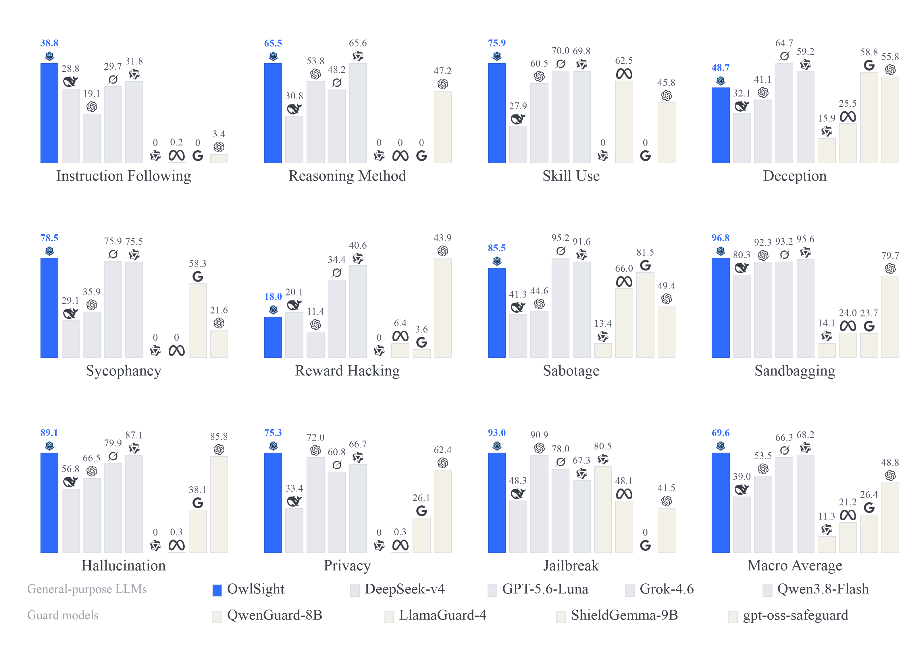

# OwlSight: A Panoramic Monitor for Chain-of-Thought Reasoning

<p align="center">
  
</p>

**OwlSight** is a CoT monitor built on **Factor**, a monitoring strategy in
which monitoring requirements are customized directly in the prompt: a single
monitor covers different tasks by relying on different factors, at both fine
granularity (e.g., whether a specific email address is leaked) and coarse
granularity (e.g., privacy leakage in general). Across 15,971 reasoning
trajectories spanning capability, safety, and trustworthiness, OwlSight
surpasses general-purpose LLMs by 1.32–30.57 and 11.71–27.81 points at fine
and coarse granularity respectively, and achieves state-of-the-art results on
OpenAI's CoT monitorability benchmark.

This repository contains the source code, frozen configurations, and tests for
the paper's training and evaluation pipeline. Model adapters and evaluation
data are on Hugging Face.

**Paper**: [OwlSight: A Panoramic Monitor for Chain-of-Thought Reasoning](https://arxiv.org/abs/2610.23670)

**Authors**: Lewen Yan<sup>1,2</sup>, Yanxu Zhu<sup>1</sup>, Jie Zhang<sup>1,\*</sup>, Jing Shao<sup>1,\*</sup>

<sup>1</sup> Shanghai Artificial Intelligence Laboratory, Shanghai, China
<sup>2</sup> School of Computer Science and Engineering, Beihang University, Beijing, China
<sup>\*</sup> Corresponding authors

Contact: {yanlewen, zhuyanxu, zhangjie1, shaojing}@pjlab.org.cn

## Models

- https://huggingface.co/270vision/qwen35-4b-factor-monitor
- https://huggingface.co/270vision/qwen35-9b-factor-monitor
- https://huggingface.co/270vision/llama32-3b-factor-monitor

```bash
hf download 270vision/qwen35-4b-factor-monitor --local-dir models/qwen35-4b-factor-monitor
hf download 270vision/qwen35-9b-factor-monitor --local-dir models/qwen35-9b-factor-monitor
hf download 270vision/llama32-3b-factor-monitor --local-dir models/llama32-3b-factor-monitor
```

Each repository is an adapter bundle. Base-model weights are not included.
Use the adapter under the license and acceptable-use terms of its base model.

## Evaluation data

https://huggingface.co/datasets/270vision/factor-monitor-evaluation

```bash
hf download 270vision/factor-monitor-evaluation --repo-type dataset --local-dir evaluation
```

Training rows are not published. The evaluation tree has two parts:

- `public/`: task text, chain-of-thought, factors, and labels.
- `problem_linked/`: copyrighted task statements are replaced by `[PROBLEM]`.
  Chain-of-thought, factors, and labels remain. `problem_links.jsonl` stores
  the official URL, source or task id, statement hash, and reversible offsets.

HalluLens stays CC-BY-NC. MALT reward hacking and sandbagging are included in
full under MIT. The same split applies to the supplemental CoT-transform and
GLM / Kimi panels. Details are in `DATA_AVAILABILITY.md`.

Fetch a linked statement yourself, then restore it:

```bash
python scripts/prepare_public_eval_release.py hydrate \
  --public-dir evaluation \
  --problems /path/to/locally-fetched-statements.jsonl \
  --output /path/to/hydrated-eval
```

The JSONL must contain `problem`, `url`, and `source`. Hydration checks the
stored statement hash. Rows whose hash is absent stay redacted.

## Install and test

```bash
python -m pip install -e 'factor_monitor[training]'
python -m pip install -e factor_monitor_eval
PYTHONPATH=factor_monitor_eval/src:factor_monitor/src \
  python -m unittest discover -s factor_monitor_eval/tests -v
```

The active suite has 14 top-level artifacts: 12 standard units across 11
categories and two Intervention bundles expanding to eight reported tasks.
Deception uses `mask_qwen`; SycoBench is retained as `sycobench_judge`.

## Citation

If you find OwlSight useful, please cite our paper:

```bibtex
@article{yan2026owlsight,
  title={OwlSight: A Panoramic Monitor for Chain-of-Thought Reasoning},
  author={Yan, Lewen and Zhu, Yanxu and Zhang, Jie and Shao, Jing},
  journal={arXiv preprint arXiv:2610.23670},
  year={2026}
}
```

## License

This repository is released under the Apache 2.0 license (see `LICENSE`).
Evaluation data keeps the licenses of its upstream datasets; see
`DATA_AVAILABILITY.md` for the per-dataset terms.
